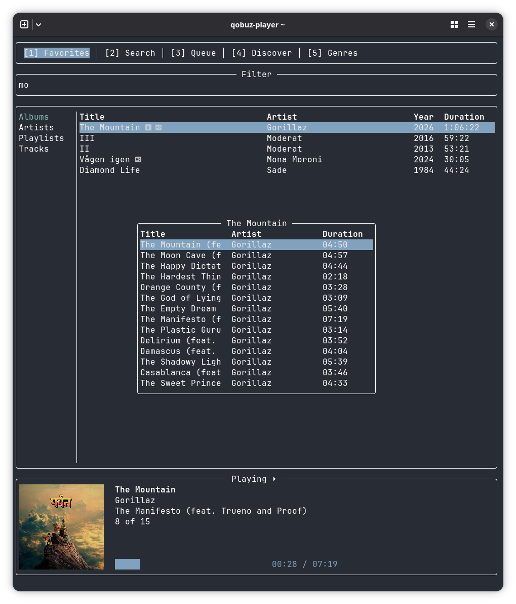

# qobine (TUI-only fork)

## High resolution audio player backed by Qobuz

Powered by [Qobuz](https://www.qobuz.com). Requires a paid subscription. This does not allow you to listen for free.

This is a personal fork of [qobine](https://github.com/SofusA/qobine), trimmed down to only
support the **terminal UI (TUI) player**. The GNOME/GTK app, web UI/server, RFID player, and
Flatpak packaging have all been removed to keep this fork focused and lightweight.

### Terminal UI


[More info](/tui-module)

## Connect
### Qobuz Connect
The TUI has initial support for Qobuz Connect, and there is also a standalone minimal connect
player. This can be enabled with the `--connect` flag.
However this is currently very limited, experimental and full of bugs.

[More info on Connect player](/connect-module)

### Qobine Disconnect
Support for a custom self-hostable connect service, `Disconnect`, which allows activating and
deactivating multiple running players. This does **not** work with the official qobuz
smartphone app or web player.

This can be used if you are running multiple players in your home and want a shared activation
service.

[More info on Disconnect](/disconnect-module)

### Build from source
Linux dependencies: `alsa-sys-devel`.
```
cargo build
```

### Run the terminal app locally
```
./run-tui.sh
```

Pass arguments through as usual, for example:
```
./run-tui.sh login
```

## Development
Linux dependencies: `alsa-sys-devel`, `just`, `sqlx-cli`.
1. Setup sqlx: `just create-env-file`. Only needed once. 
2. Init sqlite database: `init-database`.

## Get started
Run `--help` or `<subcommand> --help` to see all available options.

## Contribution
Feature requests, issues and contributions are very welcome.

## Credits
Qobine started as a fork of [hifi.rs](https://github.com/iamdb/hifi.rs) but has since diverged.
This fork of [SofusA/qobine](https://github.com/SofusA/qobine) trims the project down to just
the TUI player.
